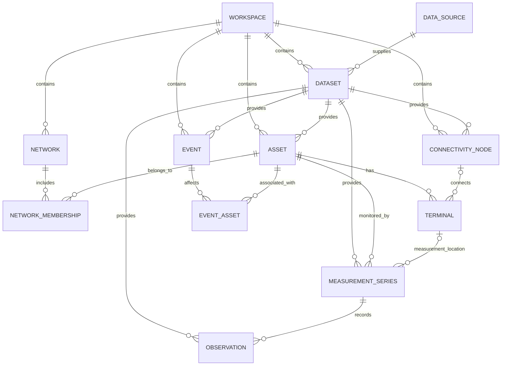

# Default data model · version 1

Geobound separates geographic location, physical network relationships, measurements, and provenance. The interchange format is a JSON bundle validated by [the JSON Schema](../schemas/twin.schema.json) and semantic relationship validation. All array names below are literal bundle keys.

## Entities

| Entity / bundle key | Required fields | Optional fields / notes |
|---|---|---|
| Workspace / `workspace` | `id`, `name`, `timezone`, `serviceArea` | Single workspace per bundle; service area is WGS84 GeoJSON. |
| DataSource / `sources` | `id`, `name`, `custodian`, `categories`, `location`, `format`, `attribution`, `licenseUrl`, `authentication`, `configurationState`, `adapterStatus` | `description`, `futureAdapter`; location is null for unconfigured systems or imported local files. |
| Dataset / `datasets` | `id`, `workspaceId`, `sourceId`, `name`, `version`, `acquiredAt`, `isSynthetic`, `bounds`, `crs`, `schemaVersion` | Bounds are `[west,south,east,north]`; CRS is `EPSG:4326`. |
| Network / `networks` | `id`, `workspaceId`, `utilityType`, `name`, `kind` | Electric feeder, water zone, or gas district. |
| Asset / `assets` | `id`, `workspaceId`, `datasetId`, `externalId`, `utilityType`, `assetType`, `name`, `geometry`, `status`, `attributes` | Attributes carry utility-specific equipment properties. |
| NetworkMembership / `networkMemberships` | `networkId`, `assetId` | Unique pair; equipment may belong to several networks. |
| ConnectivityNode / `nodes` | `id`, `workspaceId`, `datasetId`, `utilityType`, Point `geometry`, `attributes` | Engineering voltage/pressure metadata may be supplied. |
| Terminal / `terminals` | `id`, `assetId`, `label` | `nodeId`, `phases`; absent node means an unconnected terminal. |
| MeasurementSeries / `series` | `id`, `assetId`, `datasetId`, `quantity`, `unit` | `terminalId`, `phase`, positive `sampleIntervalSeconds`. |
| Observation / `observations` | `seriesId`, `observedAt`, `value`, `quality`, `datasetId` | Unique `(seriesId, observedAt)`; null value requires `missing` quality. |
| Event / `events` | `id`, `workspaceId`, `datasetId`, `type`, `severity`, `status`, `startedAt`, `endedAt`, `description` | End may be null; cannot precede start. |
| EventAsset / `eventAssets` | `eventId`, `assetId` | Unique pair; events can affect several assets. |

## Identity and topology

IDs are stable and unique within their entity table and workspace. External asset IDs are unique within a dataset and retained separately. All references must resolve inside the bundle, and referenced networks/nodes must have the same utility type as their assets. A series referring to a terminal must refer to that terminal's asset.

Terminals establish adjacency through a shared connectivity node. A transformer may have primary, secondary, and further terminals; lines normally have two terminals when supplied by a topology source. Shared equipment can belong to multiple networks. Colocated assets are not automatically connected. Public and imported geometry-only assets remain inspectable and show unavailable connectivity.

## Public-source records

The startup workspace uses `substation`, `transmission_line`, and `gas_main` asset types. It has no fabricated networks, memberships, terminals, observations, or events. ArcGIS internal IDs combine the source ID and the service's advertised object identifier, including `OBJECTID_1` where required. Gas pipeline IDs use the dataset's `fid`. Original identifiers and attributes remain in `Asset.attributes.sourceAttributes`; known positive transmission voltages are converted from kV to `nominalVoltageV`. Unknown sentinel values remain in the original attributes and do not become engineering values.

Datasets may additionally carry `isRemote`, `sourceUpdatedAt` (UTC provider metadata timestamp), and `queryBounds` (the WGS84 area requested). `acquiredAt` remains fetch time. Assets retain their own `sourceFetchedAt` when they are pinned from an earlier area. Refreshes replace only a successfully loaded public dataset, retaining imported datasets and public assets referenced by measurements, topology, events, or the current selection. An exported workspace preserves source IDs and geometry; importing it as another workspace creates an independently editable snapshot.

The first version highlights direct recorded neighbors. It does not infer energization, downstream outage effects, hydraulic flow, gas flow, or internal device switching behavior.

## Geometry, time, and observations

Supported geometry types are Point, MultiPoint, LineString, MultiLineString, Polygon, and MultiPolygon. Coordinates use `[longitude, latitude]`, optionally a supplied height; polygons have closed rings. Preserve any declared elevation reference in asset attributes, such as `heightReference`. Public source records have no surveyed heights unless explicitly supplied. 3D display offsets never change stored geometry.

Bundle timestamps are valid RFC 3339 UTC strings ending in `Z`. CSV timestamps can have explicit UTC offsets and are normalized to UTC on import. The workspace IANA timezone controls display only.

Series retain explicit quantity and unit strings. Different units or phases produce separate CSV-imported series. Values are not silently converted. Quality is `good`, `suspect`, `missing`, `synthetic`, or `unknown`. Null values appear as chart gaps, as do absent intervals when a series declares its expected sample interval.

## Utility extensions

| Utility | Registered asset types | Typical attributes |
|---|---|---|
| Electric | substation, transmission_line, overhead_line, underground_cable, pole, transformer, switch, meter | `phases`, `nominalVoltageV`, `secondaryVoltageV`, `ratingKva`, `mounting`, `switchPosition` |
| Water | reservoir, pump, water_main, valve, hydrant, water_meter | `diameterMm`, `material`, `pressureKpa` |
| Gas | gas_main, regulator, gas_valve, gas_meter, compressor | `diameterMm`, `material`, `pressureKpa` |

Electric terminal phases are A/B/C/N; a series may additionally use ABC. Water and gas measurements do not require phase fields. To add an asset type, extend the registry, attribute validation, import examples, display styling, and model tests. Interchange changes require a deliberate schema-version migration; this milestone accepts only version 1.

## Local OSM context

Local OSM overlays are GeoJSON context collections independent of the version 1 utility bundle. Their IDs are `osm:<node|way|relation>:<source id>`. Properties retain `osmType`, `osmId`, `version`, `timestamp`, `sourceFiles`, original `tags`, and a display category. Numeric source height tags, when present, are recorded as `heightMeters` metadata, not absolute elevation. No ownership verification, operating status, terminals, connectivity nodes, observations, or asset-network memberships are inferred from these layers. Workspace exports include the catalog definition but exclude the overlay geometry; the derived ODbL datasets are distributed separately in `public/data/osm/tampa-bay/`.

## Illustrative equipment rendering

The 3D view derives transmission supports derived from the supplied POSTE 05 model at all route turns, three-phase conductors seated on the retained upper insulators, translucent underground gas pipes, and three-phase three-winding transformer banks from published geometry for display. None become Asset, Terminal, ConnectivityNode, NetworkMembership, or MeasurementSeries records. Every selectable model points back to its source asset. Pole positions are screened against independently loaded local OSM constraints; missing or blocked locations are skipped. Temporary terrain grounding and illustrative pipe burial depth affect only rendering and are discarded with the view. Source geometry, timestamps, provenance, and exports remain unchanged. These arrangements do not assert actual winding counts, phase configuration, pipe diameter or burial depth, surveyed support positions, engineering clearances, or network operating state.
