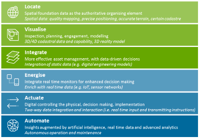
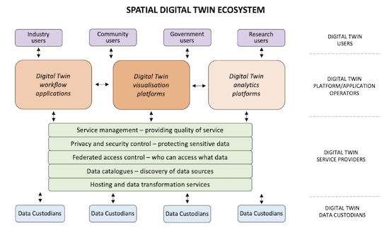
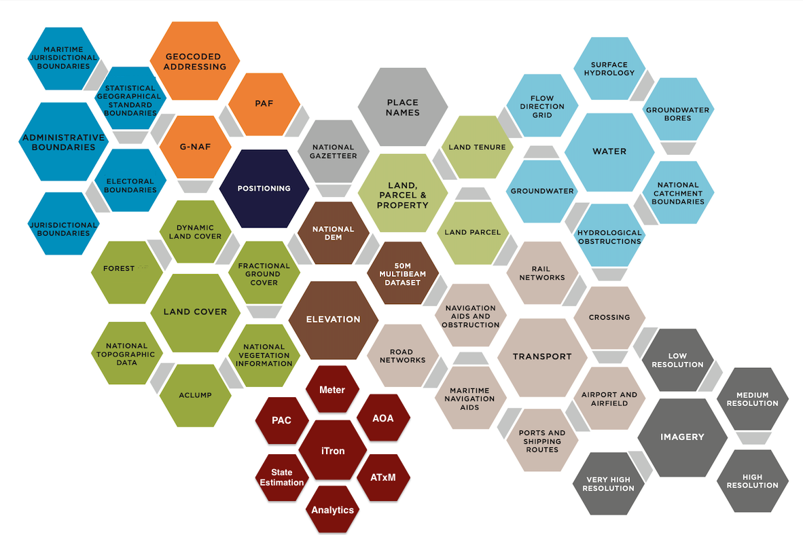

## Spatial Digital Twin

A spatial digital twin is a dynamic, location-based digital model of real-world assets, systems, or environments.  Unlike static models, spatial digital twins evolve to reflect ongoing changes in the built and natural world by integrating geospatial context with both live and historic data.  While the concept of digital twins originated in manufacturing to model equipment and production systems, spatial digital twins stand out because they anchor all data to geographic location.  This spatial foundation enables integration of extremely diverse information sources—maps, satellite imagery, 3D building models, AMI & SCADA data, and operational systems—within a unified geographic framework.  By positioning data in relation to where things physically exist and interact, spatial digital twins provide excellent context for infrastructure planning, environmental management, and operational decision making.  This makes them particularly valuable for applications such as smart cities, urban infrastructure, climate resilience, and water, gas & electric utilities.  As a result, these personnal are able to better understand and manage resources and communities over time.

### Key Data Types

#### Foundational Geospatial Data

Provides the base layer for spatial visualisation and analysis, anchoring all other data types to real-world locations. Examples include:

- Maps (topographic, cadastral, etc.)
- Satellite imagery
- Aerial photography
- GIS (Geographic Information System) data

#### 3D & Elevation Data

Adds depth and realism, enabling precise modelling of terrain, infrastructure, and natural features. Examples include:

- Building Information Modelling (BIM) data
- LiDAR (Light Detection and Ranging) scans
- Digital Elevation Models (DEM) or Digital Terrain Models (DTM)

#### Real-Time Sensor Data

Reflects dynamic, real-time conditions in the environment for live monitoring and reactive decision-making. Examples include:

- IoT (Internet of Things) sensor readings
- Weather stations
- Traffic sensors

#### Time-Series & Historical Data

Enables analysis of past trends and integration into predictive models for future planning. Examples include:

- Historical and real-time data streams
- Trends in energy usage, water flow, traffic flow
- Climate patterns over decades (e.g. rainfall or temperature changes)

#### Infrastructure & Operational Data

Provides critical information on the built environment’s functionality and supports efficient management of infrastructure. Examples include:

- Utility networks (water, electricity, gas, telecom)
- Transportation systems (roads, railways, airports)
- Performance metrics for assets and systems

#### Environmental & Climate Data

Informs sustainability and environmental impact analysis. Examples include:

- Climate data (temperature, humidity, precipitation)
- Vegetation coverage and health
- Biodiversity and wildlife distribution

#### Regulatory & Compliance Data

Ensures projects align with legal, zoning, and environmental regulations. Examples include:

- Land ownership and cadastral information
- Environmental impact assessments
- Building codes and planning permissions

#### Demographic & Socio-Economic Data

Supports urban planning, policy-making, & community impact assessments. Examples include:

- Population statistics
- Land use and zoning
- Economic activities and employment rates

#### Predictive & Simulation Data

Enables scenario testing and "what-if" analyses to evaluate the potential outcomes of decisions. Examples include:

- Predictive models (e.g., flood risk, traffic flow)
- Scenarios for climate impact or urban development

## Digital Twin Maturity model
The ability to realise the benefits of spatially enabled digital twins and use them effectively will depend on the evolving maturity (Figure 3).  Each maturity stage can provide significant and distinct value. These include visualisation capabilities from aligning spatial data for design and coordination purposes; planning capabilities from integrating static data such as digital engineering models; analytical capabilities from real time data; and management capabilities that arise from being able to control physical elements through the digital twin. As such, digital twins may only evolve to meet their respective need.
 
Governance will be required for a standards-based approach, data integration and role based access. Each stage will likely involve unique challenges, including data modernisation, changes to business processes and more technical capability. For example, an essential element to deliver a spatially enabled digital twin will be collection and availability of appropriately accurate and precise high-quality spatial data, including related metadata.

 
Figure 1: Spatially enabled digital twin maturity model illustrating the evolution in complexity, connectivity and capability. Integration of dynamic, real time data moves digital twins beyond static data platforms. Maturity stages are not necessarily linear; there are benefits in data upgrades and analytics at any stage. 
 

## Information and Technology Components of the Framework
An ecosystem of spatially enabled digital twins requires a federated data sharing model, where data and
shared resources held by different data custodians can be easily discovered and accessed. This must be
supported by the use of common standards and processes, and methods to protect private and sensitive
information. Under this model, data remains under the control of data custodians as the ‘authoritative
source of truth’ with a minimum amount of persistent data stored on shared platforms or with an
intermediary.

## Data categories

## Digital Twin Readiness Checklist

### 1. Project Overview

**Project Name:** ____________________

**Sector** (tick one or more):

- [ ] Infrastructure
- [ ] Renewables
- [ ] Government
- [ ] Research
- [ ] Energy
- [ ] Agriculture
- [ ] Urban Development
- [ ] Utilities
- [ ] Education
- [ ] Other: ____________________

### 2. Goals and Objectives

**Primary Goal:**

What do you hope to achieve with the digital twin? (tick one or more):

- [ ] Engage stakeholders and build trust
- [ ] Improve operational efficiency
- [ ] Reduce costs
- [ ] Enhance decision-making
- [ ] Streamline compliance and reporting
- [ ] Facilitate data sharing and collaboration
- [ ] Optimise resource allocation
- [ ] Other: ____________________

**Specific Objectives:**

- Objective 1: ____________________
- Objective 2: ____________________
- Objective 3: ____________________

**Key Performance Indicators (KPIs):**

- [ ] Increased stakeholder engagement
- [ ] Cost savings achieved
- [ ] Improved resource efficiency
- [ ] Other: ____________________

### 3. Digital Twin Maturity Level

**Selected Maturity Level** (tick one):

- [ ] Level 0 Locate
- [ ] Level 1 Visualise
- [ ] Level 2 Integrate
- [ ] Level 3 Energise
- [ ] Level 4 Actuate
- [ ] Level 5 Automate

**Explanation for Selection:** ____________________

### 4. Data Requirements

**Types of Data Needed** (tick all that apply):

- [ ] Foundational Geospatial Data
- [ ] 3D & Elevation Data
- [ ] Real-Time Sensor Data
- [ ] Time-Series & Historical Data
- [ ] Infrastructure & Operational Data
- [ ] Environmental & Climate Data
- [ ] Regulatory & Compliance Data
- [ ] Demographic & Socio-Economic Data
- [ ] Predictive & Simulation Data

**Data Sources and Providers:**

- [ ] Internal data systems
- [ ] Open data sources
- [ ] Purchased datasets
- [ ] Other: ____________________

**Data Integration Plan:**

- [ ] Direct data connections
- [ ] Data transformation tools
- [ ] APIs for real-time integration
- [ ] Data cleaning and preparation
- [ ] Other: ____________________

**Data Licensing and Permissions:**

- [ ] Open data (Creative Commons)
- [ ] Restricted data (confidential, legal limitations)
- [ ] Commercial data (paid licenses)
- [ ] Proprietary data (company-owned)
- [ ] Other: ____________________

### 5. Technical Requirements

**Integration Needs:**

- [ ] GIS Platforms
- [ ] IoT devices
- [ ] Enterprise systems (ERP, CRM)
- [ ] Custom APIs
- [ ] BIM software (Revit, Navisworks)
- [ ] GIS tools (ArcGIS, QGIS)
- [ ] CAD software (AutoCAD)
- [ ] IoT integration platforms
- [ ] Other: ____________________

**Data Formats** (tick all that apply):

- [ ] WMS (Web Map Service)
- [ ] KML/GeoJSON (Geospatial formats)
- [ ] CAD/BIM (DWG, IFC)
- [ ] CSV/Excel (tabular data)
- [ ] WMTS (Web Map Tile Service)
- [ ] Other: ____________________

**Infrastructure Setup:**

- [ ] Cloud storage
- [ ] On-premises servers
- [ ] Hybrid cloud
- [ ] Data backups
- [ ] Other: ____________________

### 6. Stakeholder Involvement

**Stakeholder Groups** (tick all that apply):

- [ ] Project team members
- [ ] Community representatives
- [ ] Government agencies
- [ ] Regulatory bodies
- [ ] Investors
- [ ] Contractors and suppliers
- [ ] Academic institutions
- [ ] Other: ____________________

**Roles and Responsibilities:**

- [ ] Identify Decision-makers
- [ ] Identify Data providers
- [ ] Identify End-users
- [ ] Identify Technical leads
- [ ] Other: ____________________

**Communication Plan:**

- [ ] Weekly project updates
- [ ] Monthly stakeholder meetings
- [ ] Public information sessions
- [ ] Interactive workshops
- [ ] Reports and dashboards
- [ ] Other: ____________________

### 7. Implementation Plan

**Phases of Implementation** (tick all that apply):

- [ ] Planning and design
- [ ] Data collection and integration
- [ ] Development and build
- [ ] Testing and validation
- [ ] Deployment
- [ ] Ongoing monitoring and updates

### 8. Budget and Resources

**Estimated Budget Categories:**

- [ ] Software licenses
- [ ] Hardware and infrastructure
- [ ] Data acquisition
- [ ] Personnel and training
- [ ] External consulting
- [ ] Other: ____________________

**Resource Allocation:**

- [ ] Project manager
- [ ] Data specialists
- [ ] Software developers
- [ ] Stakeholder engagement lead
- [ ] Other: ____________________

**Potential Funding Sources:**

- [ ] Internal budget
- [ ] Government grants
- [ ] Private investment
- [ ] Collaborative funding
- [ ] Other: ____________________

### 9. Risk Management Plan

**Potential Risks** (tick all that apply):

- [ ] Data quality issues
- [ ] Technical integration challenges
- [ ] Delays in development
- [ ] Licensing and compliance risks
- [ ] Budget overruns
- [ ] Other: ____________________

**Mitigation Strategies:**

- [ ] Data quality checks
- [ ] Regular technical reviews
- [ ] Contingency planning
- [ ] Legal consultation for compliance
- [ ] Other: ____________________

### 10. Success Criteria

**How Will Success Be Measured?**

- [ ] Achievement of KPIs
- [ ] Positive stakeholder feedback
- [ ] Completion within budget
- [ ] Alignment with project goals
- [ ] Other: ____________________
